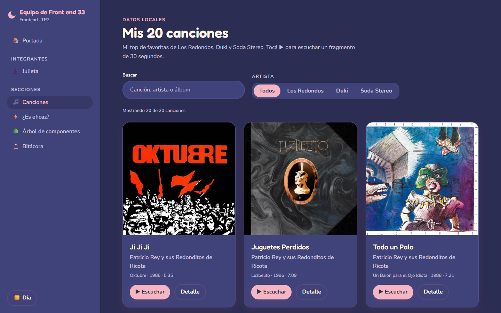
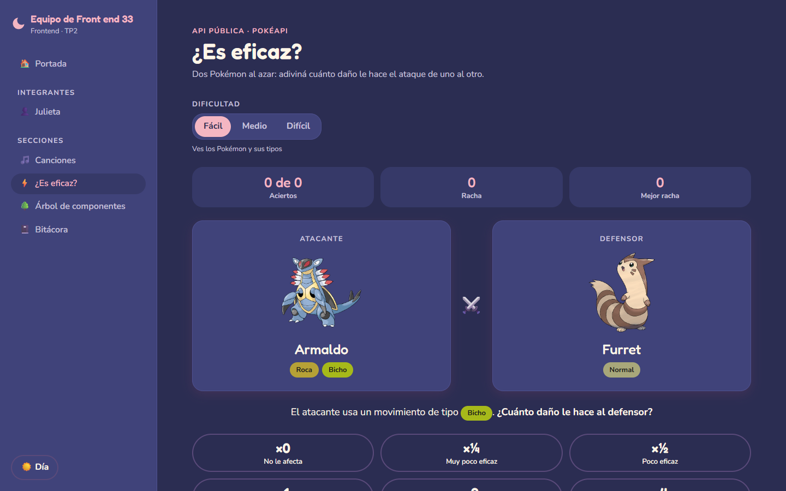
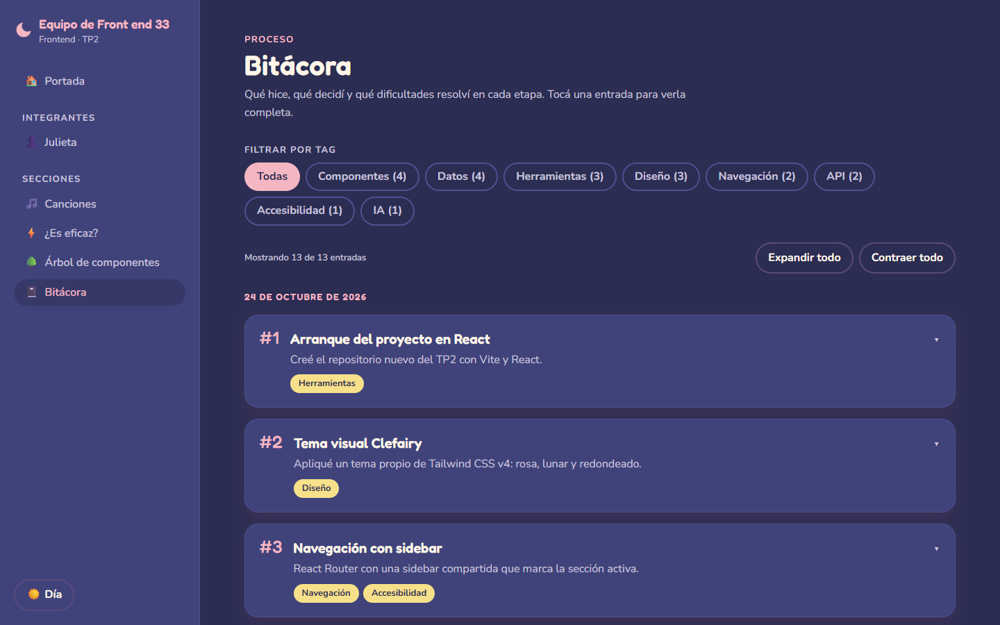

# Equipo de Front end 33 · TP2

Sitio del equipo para el Trabajo Práctico N.º 2 de Frontend: el proyecto del TP1, ahora hecho en React. Reúne el perfil de cada integrante, un top de canciones favoritas con búsqueda y filtro, un juego con la PokéAPI, el árbol de componentes de la aplicación y la bitácora del proceso.

🔗 **Sitio publicado:** [frontend-tp2.vercel.app](https://frontend-tp2.vercel.app/)
📦 **Repositorio:** [github.com/julietanatbravo/frontend-tp2](https://github.com/julietanatbravo/frontend-tp2)

## Índice

- [Integrantes](#integrantes)
- [Secciones del sitio](#secciones-del-sitio)
- [Capturas](#capturas)
- [Tecnologías](#tecnologías)
- [Cómo correrlo](#cómo-correrlo)
- [Estructura](#estructura)
- [Declaración de uso de IA](#declaración-de-uso-de-ia)

## Integrantes

Esta entrega es individual.

| Integrante | GitHub | Responsabilidades |
| --- | --- | --- |
| Julieta Natalia Bravo | [@julietanatbravo](https://github.com/julietanatbravo) | Todo el proyecto: contenido, diseño, desarrollo de las secciones, datos, deploy y documentación |

## Secciones del sitio

Todas se recorren desde la sidebar, que marca la sección activa y en celular se abre como panel lateral.

| Sección | Ruta | Qué tiene |
| --- | --- | --- |
| Portada | [`/`](https://frontend-tp2.vercel.app/) | Presentación del equipo, tarjeta de cada integrante y accesos a todas las secciones |
| Perfil | [`/integrantes/julieta`](https://frontend-tp2.vercel.app/integrantes/julieta) | Datos, habilidades y favoritos, con una pokébola que muestra un Pokémon favorito al azar (PokéAPI) |
| Canciones | [`/canciones`](https://frontend-tp2.vercel.app/canciones) | 20 canciones desde un JSON local, con búsqueda por texto, filtro por artista, vista detallada y fragmentos de 30 segundos |
| ¿Es eficaz? | [`/pokemon`](https://frontend-tp2.vercel.app/pokemon) | Juego con la PokéAPI: dos Pokémon al azar y hay que adivinar el multiplicador de daño. Tiene niveles de dificultad, mensajes de carga y de error, y reintento |
| Árbol de componentes | [`/arbol`](https://frontend-tp2.vercel.app/arbol) | Árbol desplegable generado automáticamente desde el código en cada build, así siempre coincide con lo entregado |
| Bitácora | [`/bitacora`](https://frontend-tp2.vercel.app/bitacora) | Entradas desplegables con qué hice, qué decidí y qué resolví, filtrables por tag |

Además:

- **Modo día / noche:** recuerda la preferencia y la primera vez respeta la del sistema.
- **API pública:** la [PokéAPI](https://pokeapi.co/), que no necesita clave y se consulta desde el navegador.
- **Rutas directas:** se puede entrar directo a cualquier sección o recargarla sin errores (`vercel.json`).

## Capturas

| Portada | Canciones |
| --- | --- |
|  |  |

| ¿Es eficaz? | Bitácora |
| --- | --- |
|  |  |

## Tecnologías

- [React 19](https://react.dev/) con [Vite 6](https://vite.dev/)
- [React Router 7](https://reactrouter.com/) para la navegación
- [Tailwind CSS v4](https://tailwindcss.com/) con un tema propio (paleta rosa y lunar, tipografías Fredoka y Nunito)
- [PokéAPI](https://pokeapi.co/) como API pública
- [@babel/parser](https://babeljs.io/docs/babel-parser) para generar el árbol de componentes
- Deploy en [Vercel](https://vercel.com/)

## Cómo correrlo

Requisitos: [Node.js](https://nodejs.org/) 20 o superior (probado con 20.18) y npm.

```bash
git clone https://github.com/julietanatbravo/frontend-tp2.git
cd frontend-tp2
npm install
npm run dev
```

| Comando | Descripción |
| --- | --- |
| `npm run dev` | Levanta el servidor de desarrollo |
| `npm run build` | Genera la versión de producción en `dist/` |
| `npm run preview` | Sirve localmente la versión de producción generada |
| `npm run lint` | Revisa el código con ESLint |

## Estructura

```
frontend-tp2/
├── public/                # Archivos estáticos (favicon, foto de perfil)
├── scripts/
│   └── component-tree.js  # Genera el árbol de componentes desde el código (plugin de Vite)
├── src/
│   ├── components/
│   │   ├── home/          # Portada (MemberCard, SectionCard, MoonIllustration)
│   │   ├── layout/        # Layout, Sidebar y Brand (identidad del equipo)
│   │   ├── log/           # Bitácora (LogEntry)
│   │   ├── pokemon/       # Juego "¿Es eficaz?" (PokéAPI)
│   │   ├── profile/       # Perfil de integrante (FavoritePokemon, FavoriteList)
│   │   ├── songs/         # Canciones (SongCard, SongDetail, SongFilters, PlayButton)
│   │   ├── tree/          # Árbol de componentes (TreeNode, TreeLegend)
│   │   ├── ui/            # Componentes base: Button, Card, Input, Badge, Modal, ConfirmDialog, Disclosure, SegmentedControl
│   │   └── ThemeToggle.jsx
│   ├── data/              # Datos locales en JSON (equipo, integrantes, canciones, bitácora…)
│   ├── hooks/             # useTheme, usePokemonRound, useAudioPreview
│   ├── pages/             # Una página por ruta
│   ├── services/          # Consultas a la PokéAPI
│   ├── styles/            # Tema de Tailwind CSS v4
│   ├── utils/             # Funciones auxiliares
│   ├── App.jsx            # Componente principal con las rutas
│   ├── main.jsx           # Punto de entrada
│   └── index.css          # CSS principal (importa el tema)
├── index.html
├── vercel.json            # Redirige todas las rutas a index.html (React Router)
└── vite.config.js
```

## Declaración de uso de IA

| Integrante | Aplicación | Modelo | En qué tareas |
| --- | --- | --- | --- |
| Julieta Natalia Bravo | Claude Code (extensión de VS Code) | Claude Opus 5.5 | Escritura y prueba del código de todas las secciones, armado de los datos de las canciones desde el catálogo de iTunes, borrador de las entradas de la bitácora y de este README |

Las decisiones de qué construir, el contenido del perfil y las elecciones de diseño fueron propias. Cada parte se probó en el navegador y las entradas de la bitácora se revisaron antes de publicarlas.
